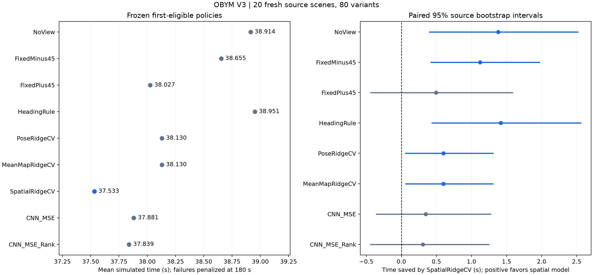

# Observe Before You Move

A robot navigating from partial depth observations can spend simulated time turning for one extra look. OBYM V3 tests whether a policy can choose when that look saves more time than it costs.

## V3 held-out result

On 20 held-out source layouts with four mirror/travel variants each, **SpatialRidgeCV saved 1.381 s (3.55%) versus NoView**. Its paired 95% source-bootstrap interval was **[0.402, 2.515] s**. The intervals versus FixedPlus45 and both CNNs included zero. The eight comparisons use unadjusted intervals.

| Policy | Mean simulated time (s) | Optional looks | Safe successes |
| --- | ---: | ---: | ---: |
| NoView | 38.914 | 0 | 80/80 |
| FixedMinus45 | 38.655 | 80 | 80/80 |
| FixedPlus45 | 38.027 | 80 | 80/80 |
| HeadingRule | 38.951 | 40 | 80/80 |
| PoseRidgeCV | 38.130 | 80 | 80/80 |
| MeanMapRidgeCV | 38.130 | 80 | 80/80 |
| SpatialRidgeCV | 37.533 | 64 | 80/80 |
| CNN_MSE | 37.881 | 45 | 80/80 |
| CNN_MSE_Rank | 37.839 | 50 | 80/80 |



Each policy decides once at the first eligible state. The experiment ran three action branches on each of the 80 variants, for **240 executed test episodes**. Nine policies select from those same deterministic branches, yielding **720 policy outcomes**. NoView continues routine depth sensing and skips the optional look. The primary metric includes simulated turning and sensing costs. Model inference wall time is recorded separately.

## Reproduce the release

From the repository root with Python 3.12:

```powershell
python tools/verify_v3_release.py
python -m pip install -r requirements-v3-results.txt
python -m tools.v3 stats --output results/v3-reproduced
```

This checks the frozen bundle and regenerates the statistics and all eight bootstrap intervals from the archived branch outcomes and frozen decision evidence. For CPU model prediction parity, optional simulation or retraining, and trace archives, see the [V3 methodology and reproduction guide](docs/V3_METHODOLOGY.md).

The frozen protocol is [94fd47e48b4f](data/v3/results/v3-final-protocol/94fd47e48b4f/protocol.json). The [original report](data/v3/results/v3-final-test/94fd47e48b4f/reports/test_summary.json) and [paired intervals](data/v3/results/v3-final-test/94fd47e48b4f/reports/paired_comparisons.json) retain full precision.

## Historical V2 experiment

The earlier PostTurnReplan experiment, its CNN results, figures, and reproduction commands are available in the [V2 archive guide](V2.md). V2 has a separate held-out evaluation, policy set, and controller configuration. Its [verification record](VERIFICATION.md) covers that historical release.
