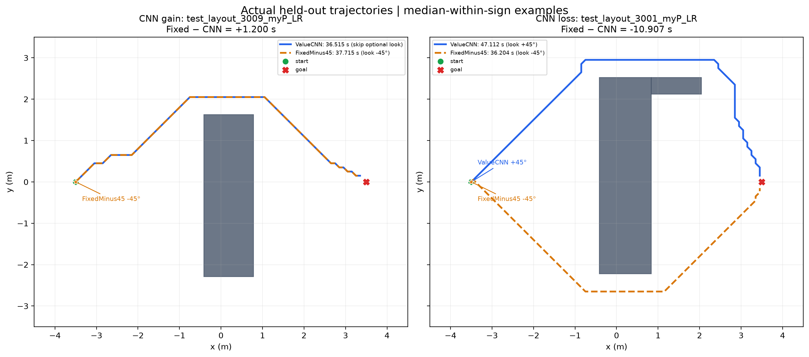
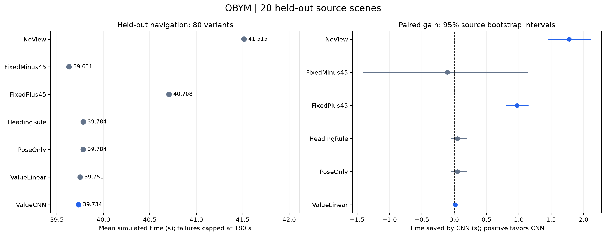

# Observe Before You Move V2 (historical)

A robot navigating from partial depth observations can spend time turning for one additional look. When does that look save more travel time than it costs?



The routes above come from real held-out motion logs: the left is a representative CNN gain and the right a loss. In the left case, CNN skips the optional look and follows the same route; in the right case, the two look directions lead to different routes. These examples illustrate the robot's decision; the aggregate comparison uses all 80 variants.

## Result

The held-out test contains 20 source scenes, with four mirror/travel variants each (80 variants). It contains 480 executed simulation runs and 560 result entries: HeadingRule is a derived reuse of its recorded equivalent policy. All seven policies reached the goal without recorded contact attempts on all 80 variants.

| Policy | Mean simulated time (s) | Optional looks | Goal/contact-free |
| --- | ---: | ---: | ---: |
| NoView | 41.514696 | 0 | 80/80 |
| FixedMinus45 | 39.630886 | 80 | 80/80 |
| FixedPlus45 | 40.707834 | 80 | 80/80 |
| HeadingRule | 39.784046 | 40 | 80/80 |
| PoseOnly | 39.784046 | 40 | 80/80 |
| ValueLinear | 39.750515 | 80 | 80/80 |
| ValueCNN | 39.734265 | 67 | 80/80 |



ValueCNN saved **1.780431 s** on average versus NoView (about **4.29%**), with a 95% source-scene bootstrap interval of [1.466308, 2.106152] s. FixedMinus45 had the lowest observed mean. ValueCNN versus FixedMinus45 was −0.103379 s (95% interval [−1.400621, 1.131777] s), so that interval crosses zero; this repository does not claim the CNN beat every baseline.

“NoView” means no *optional* look. It still performs the routine depth sensing used for navigation. The reported target is paired **simulated navigation time** without the optional look minus time with it. Model inference wall time is logged separately and is not added to the simulated time.

## How a depth observation becomes an action

`depth image → occupancy map → route-relevant unknown region → −45°/+45° candidate encodings → predicted net time saving → navigate or observe`

Metric depth is back-projected through the camera intrinsics and pose into world coordinates. Rays mark traversed voxels free and observed endpoints occupied. Four height layers collapse into a 0.1 m occupancy grid: any occupied layer blocks a cell, all-free layers make it free, and the remainder stays unknown. The planner inflates obstacles by the robot radius plus clearance and assigns unknown space a larger travel cost. Routine observations update this map throughout navigation.

The V2 input has seven binary map channels: free, occupied, unknown, route-unknown, candidate-position, predicted-new-view, and valid-world; plus a six-value pose vector. The saved ensemble decodes predicted net seconds saved for the two candidate turns. [`choose_one_look`](src/obym/decision.py) selects the best candidate only if it exceeds the recorded 0.15 s threshold; the policy has a one-optional-look budget. [`inference.py`](src/obym/inference.py) loads the verified CPU model, and [`encoding.py`](src/obym/encoding.py) defines the input contract.

Training targets compare paired continuations from a shared state: no optional view versus a candidate turn and observation. The target is the resulting net simulated time saving, including turning and sensing costs. Three CNN members predict standardized signed seconds; the ensemble averages their decoded values. Training uses 24 source scenes and validation uses six different sources, each expanded into four variants; held-out sources are separate. The model chooses whether and in which direction to look, rather than predicting a collision-free route directly.

The data were collected and tested with the V2 **PostTurnReplan** controller: after an optional view, occupancy is updated and the route is replanned. A later initial-centering/first-movement audit changed controller behavior and is deliberately not part of this main experiment.

## Results-only quickstart

From the repository root, this needs only Python, NumPy, and Matplotlib—no PyBullet, PyTorch, GPU, model server, or notebook state.

```powershell
python -m pip install -r requirements-results.txt
python tools/reproduce_results.py --root . --output results/generated
```

It recomputes the seven-policy table, all six source-bootstrap intervals (10,000 draws, seed 20261102), the decision analysis, both figures, and a standalone `results/generated/replay.html`. The table is also saved as `policy_table.csv` and `test_summary.json`. Open the HTML file in a browser to replay saved positions and headings against simulated time. The replay shows poses and obstacles, not map evolution. All inputs are bundled in [`data/heldout`](data/heldout) and [`data/traces`](data/traces).

## Decision analysis

The compact, auditable [per-variant CSV](data/heldout/reports/cnn_vs_fixedminus45_decisions.csv) was read from each pair’s `heldout_decisions.json`, not inferred from elapsed time. There were **38 matching** and **42 differing** decisions. Among the differing decisions, CNN had **35 wins, 0 ties, and 7 losses**; the mean paired gain was **−0.196912 s** (FixedMinus45 time minus CNN time, so positive favors CNN). A tie is `|gain| ≤ 1e-6 s`. Over all 80 pairs the same signed difference is **−0.103379 s**, reproducing the published CNN-versus-FixedMinus45 value.

Choices match only when the optional look occurs at the same decision index and angle; a skipped optional look is distinct from an observed look. Both skipping would count as matching. The bundled [compressed archive](data/heldout/heldout_decisions.json.gz) retains all 160 original decision logs, including NAVIGATE decisions, so the CSV can be independently regenerated with `python tools/analyze_decisions.py --root . --output results/generated`.

The selection rule for the route figure is recorded in [`selected_examples.json`](data/traces/selected_examples.json): among differing decisions, choose the case closest to the median strict-positive or strict-negative gain, then break ties by scene name. Obstacles come from the matching held-out manifest; stars mark the optional look. The figure shows only motion trajectories, because the saved selected traces do not provide time-indexed map evolution.

## Reproduction paths

The small, verified artifacts are bundled:

- Held-out manifest, 560 portable result records, summary, paired comparisons, and per-episode metrics: [`data/heldout`](data/heldout).
- Two selected pairs of actual `motion.json` trajectories: [`data/traces`](data/traces).
- V2 train/validation tensors (247,763 and 71,477 bytes), checkpoint (931,069 bytes), inference probe (3,958 bytes), and baseline prediction references (7,821 bytes): [`data/dataset`](data/dataset) and [`data/model`](data/model).

The checkpoint SHA-256 is `f12ff1a51d6e54d71ad5805ba7b5b455202f51e1bd182e8c4c56307565bc984b` and is recorded in the held-out manifest. Verify the extracted model on CPU:

```powershell
python -m pip install -r requirements-model.txt
python tools/verify_model_probe.py
```

For retraining from the bundled V2 tensors, use an isolated Python process on Windows (the script sets sequential MKL/OpenMP thread settings and PyTorch to one thread):

```powershell
python tools/train_v2.py --dataset data/dataset --output results/trained_v2
```

The committed checkpoint is the verified artifact. A fresh run can legitimately have a different checkpoint hash on a different PyTorch build; compare its predictions and held-out evaluation separately rather than changing an expected hash.

The training entry point launches the exact archived worker from notebook 02, including the linear and pose baselines. It requires a new output directory and leaves the frozen model untouched. Training is optional and was not rerun when preparing this repository.

For simulation and evaluation on Windows, use the Conda environment below. It uses the same conda-forge PyBullet 3.25 package family as the original experiment and avoids a local C++ build. Activate the environment so NumPy can find its runtime DLLs. [`simulation.py`](src/obym/simulation.py) contains the extracted depth mapping, planning, encoding, motion, and PostTurnReplan definitions. [`evaluate.py`](tools/evaluate.py) loads case geometry and costs from the held-out manifest, generates a NoView prefix, and evaluates the requested policy with the original prefix checks. PyTorch runs in a separate child process with sequential MKL/OpenMP settings; no external service is needed.

```powershell
conda env create -f environment-simulation.yml
conda activate obym-simulation
python tools/evaluate.py --scene test_layout_3001_myP_LR --method ValueCNN --parity --output results/episode_parity
```

This checks one representative archived case (NoView plus ValueCNN), including time, distance, outcome, looks, contact attempts, observations, and planning cycles. A cheaper geometry-only initialization check is `python tools/smoke_parity.py`. For a different case, pass its name from the manifest and a fresh output directory. `--method all` executes six policies and derives HeadingRule; `--all-cases --method all` explicitly requests the full evaluation and is expensive. The default command runs one case. Saved artifacts are sufficient for the results quickstart, and a full evaluation is unnecessary to verify the reported table.

On platforms with a compatible PyBullet binary or build toolchain, `python -m pip install -r requirements-simulation.txt` is an alternative. The results-only quickstart does not need either simulation environment.

For this V2 workflow, the later audit is preserved separately in [`initial_centering_audit.py`](src/obym/initial_centering_audit.py), and never applied by evaluation. Extraction details, notebook hashes, and the frozen runner hash are recorded in [workflow provenance](data/workflow_provenance.json). The export command, for maintainers who still have the original experiment folder, is:

```powershell
python tools/build_artifacts.py --source ../observe-before-you-move --destination .
```

Set `--source` to the actual original experiment directory. The exporter reads each result's `directory` to locate its episode traces, converts the aggregate evidence to portable records, and re-derives the CSV and figures without modifying the source. The original artifacts are `results/ml/task_value_v2/97e8ab583a96/`, `results/ml/task_value_v2_training/20261101_231250_751344/ensemble.pt`, and `results/ml/heldout_v2_navigation/fa34bcbcb4a4/` under that directory. The compact public files retain the full-precision values from `results.json` and the manifest. Bulk maps, RGB frames, and the other 476 motion traces remain in the local archive; rerunning evaluation regenerates these logs.

## Protocol and limits

Scenes are synthetic instances of three shared templates (barrier, gate-open, and gate-closed). Every source has four variants from mirror and travel direction; bootstrap resampling keeps those four variants together at the source-scene level. A failed or contact-attempt run would be capped at 180 s, although none occurred here. Candidate looks are limited to −45° and +45° and at most one optional look.

This is simulation evidence, not a physical-robot result. The task uses fixed camera, motion, turn, and sensing costs documented in the [held-out manifest](data/heldout/manifest.json); conclusions may be sensitive to controller and cost choices. In the *sampled* V2 train and validation states, every positive label occurred at the initial decision; that observation is scoped to those sampled data, not a general claim about later observations.

The original exploratory notebooks, obsolete checkpoints, raw 480-run directories, caches, and machine-specific logs are intentionally excluded. This repository contains the evidence needed to inspect and reproduce the reported results; it does not imply a publication, DOI, affiliation, or acceptance status. See the [verification record](VERIFICATION.md) for the checks performed on this public checkout. The paper manuscript is deferred.
